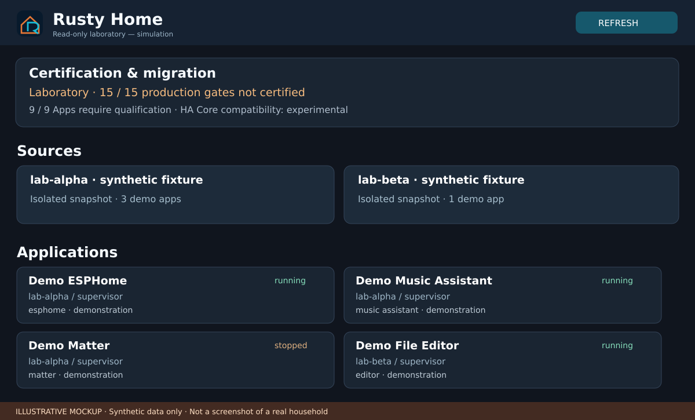

<h1 align="center">Rusty Home</h1>

<strong>La domotique réinventée en Rust.</strong> Un moteur domotique local et natif, pensé pour coexister avec l'écosystème Home Assistant.

<a href="README.md">English</a> · <a href="README.fr.md">Français</a> · <a href="README.zh-CN.md">简体中文</a>

> [!WARNING]
> **Prototype de recherche, pas encore une alternative prête à Home Assistant.** Ne branchez aucun appareil réel, ne transférez aucune configuration de production et ne confiez aucune radio à ce logiciel. Les **15 critères de production sont toujours bloqués**. L'inventaire des 29 intégrations personnalisées et des neuf Apps HAOS ne démontre pas leur compatibilité complète.

## Une autre base pour la domotique

Rusty Home est un projet **indépendant, Rust-first** : moteur d'état local et durable, automatisations, compatibilité Home Assistant optionnelle, migration réversible et exploitation sécurisée. Ce **n'est pas un fork Home Assistant** ni une distribution installable à domicile.

| Démontré en laboratoire isolé | Reste à certifier |
| --- | --- |
| Moteur Rust expérimental, événements et automatisations, tests SIGKILL | Pilotes d'appareils et contrôle exclusif des radios |
| Interface de lecture seule pour inventaires fictifs et signés | Identités, authentification et transport hôte de production |
| Tests réels Home Assistant Core pour certaines intégrations HACS | Les 29 intégrations et les neuf Apps |
| Essais de sauvegarde/restauration dans une VM HAOS isolée | Migration réelle, restauration des données, retour arrière |
| Critères de certification stricts et tests de sécurité | Performances système, packaging et licences tierces |

## Aperçu de l'interface

Maquette illustrative fidèle à la structure du prototype, avec données fictives : aucune capture d'équipement connecté.

## Architecture

~~~text
Rusty Home — laboratoire
 ├── Rust : états, événements, automatisations, durabilité
 ├── Interface web de lecture seule + critères de certification
 ├── Compatibilité Python Home Assistant isolée (facultative)
 └── Futurs pilotes, propriété des appareils, Apps : non certifiés
~~~

Pour les détails : [architecture](docs/ARCHITECTURE.md), [composants étudiés](docs/UPSTREAMS.md), [sécurité](docs/SECURITY.md) et [critères de production](docs/PRODUCTION_READINESS_2026-10-18.md).

## Premiers tests — uniquement en environnement isolé

Nécessite Rust, Python 3 et Linux ; certains tests avancés demandent Docker ou QEMU.

~~~bash
git clone https://github.com/GodsQuantum/Rusty-Home-Open.git
cd Rusty-Home
cargo test --locked --all
python3 scripts/check_release_gate.py --expect-blocked
bash scripts/test-lab.sh
~~~

Ces tests ne commandent aucun appareil et n'autorisent aucune mise en production. N'utilisez pas de sauvegarde HAOS réelle ni d'identifiants privés.

## En savoir plus

[Avancement](STATUS.md) · [Feuille de route](docs/ROADMAP.md) · [Preuves techniques](docs/RELEASE_STATUS.md) · [Préparation à la publication](docs/PUBLIC_RELEASE_CHECKLIST.md) · [Contribuer](CONTRIBUTING.md) · [Charte graphique](branding/PALETTE.md)

**Mentions légales :** un audit des licences, de l'historique et des données privées est nécessaire avant publication. Voir [provenance](docs/THIRD_PARTY_PROVENANCE.md). Rusty Home est indépendant de Home Assistant / Nabu Casa.
