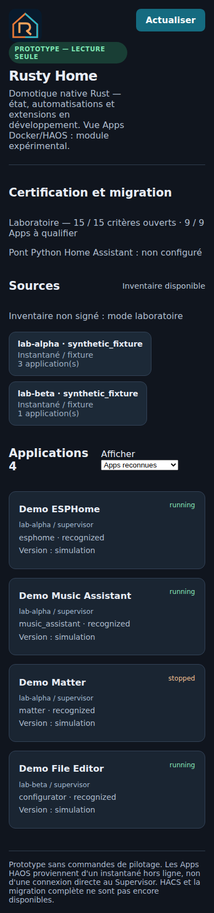

> [!CAUTION]
> **开发暂停 — 实验性源代码 — 尚不可用于生产环境。** 原维护者已暂停开发，不提供安装支持或发布日期。欢迎社区 Fork 和 Pull Request，但不保证审查或合并。请勿连接真实设备或导入个人 HAOS 备份。**15 项生产认证均未通过（0/15）。** 参见[项目状态](docs/PROJECT_STATUS.md)和[贡献指南](CONTRIBUTING.md)。

<h1 align="center">Rusty Home</h1>

<strong>用 Rust 重新构想家庭自动化。</strong> 探索原生、以本地为中心的自动化引擎，并逐步兼容 Home Assistant 生态。

<a href="README.md">English</a> · <a href="README.fr.md">Français</a> · <a href="README.zh-CN.md">简体中文</a>

> [!WARNING]
> **这是研究原型，还不能替代 Home Assistant。** 请勿连接真实家庭设备、迁移生产配置或交给本项目独占控制无线协调器。**15 项必要的生产认证门槛全部尚未通过**。29 个自定义集成和 9 个 HAOS 附加应用的清单，不代表完整的运行时兼容性。

## 为什么开发 Rusty Home？

Rusty Home 是一个**独立的 Rust 优先项目**，研究持久化本地状态、自动化、可选的 Home Assistant 兼容层和可回滚的迁移。它**不是 Home Assistant 的分支**，目前也不是可直接安装的家庭自动化发行版。

| 已在隔离实验环境中验证 | 仍需认证 |
| --- | --- |
| 原生 Rust 状态、事件与自动化实验及 SIGKILL 恢复测试 | 真实设备驱动及无线协调器独占权 |
| 只读仪表盘、签名与模拟应用清单 | 生产环境身份验证与主机通信 |
| 部分 HACS 集成在真实隔离 Home Assistant Core 中的测试 | 全部 29 个自定义集成及 9 个附加应用 |
| 独立 HAOS 虚拟机备份/恢复实验 | 真实迁移、数据恢复及回滚 |
| 发布门槛检查器与安全实验 | 完整性能、软件打包及第三方许可 |

## 实验室界面

  

真实 Rusty Home 网页前端的 Playwright 截图（在 GitHub 免费运行器上生成），仅含四个模拟应用，没有连接任何真实家庭设备。

## 架构概览

~~~text
Rusty Home（实验阶段）
 ├── 原生 Rust：状态、事件、自动化和持久化
 ├── 只读 Web/API 和发布门槛
 ├── 可选：隔离的 Home Assistant Python 兼容层
 └── 未来：设备驱动、硬件所有权、附加应用（未认证）
~~~

技术文档：[架构](docs/ARCHITECTURE.md) · [上游组件](docs/UPSTREAMS.md) · [安全](docs/SECURITY.md) · [生产认证门槛](docs/PRODUCTION_READINESS_2026-10-18.md)。

### Home Assistant Marketplace 兼容计划

Home Assistant **2026.11（尚未正式发布）**将 HACS 集成进 Core，
名称为 **设置 > Marketplace**。Rusty Home 已实现并测试连接官方 Core
Marketplace WebSocket **只读命令**的 Rust 适配层。软件安装、更新、
GitHub OAuth 以及旧 HACS 数据迁移均由 **Home Assistant Core** 管理，
不会在 Rusty Home 中重复实现商店。**2026.10 仍使用独立 HACS**；
HAOS Apps 则通过 Supervisor 管理。此功能尚未获得生产认证。

详见[架构与兼容性测试](docs/MARKETPLACE_CORE_2026_11_ARCHITECTURE.md)。

## 开发者快速开始：仅用于隔离实验环境

需要 Rust、Python 3 和 Linux；部分高级实验需要 Docker/QEMU。

~~~bash
git clone https://github.com/GodsQuantum/Rusty-Home-Open.git
cd Rusty-Home
cargo test --locked --all
python3 scripts/check_release_gate.py --expect-blocked
bash scripts/test-lab.sh
~~~

这些命令**不会**授权部署到真实家庭。不要导入实际 HAOS 备份或提供生产凭据。

## 项目文档

[开发状态](STATUS.md) · [路线图](docs/ROADMAP.md) · [技术证据](docs/RELEASE_STATUS.md) · [公开发布检查表](docs/PUBLIC_RELEASE_CHECKLIST.md) · [贡献指南](CONTRIBUTING.md) · [视觉规范](branding/PALETTE.md)

**法律说明：** 公开发布前仍需审核历史敏感信息、作者权利与第三方许可证，详见[来源与许可证](docs/THIRD_PARTY_PROVENANCE.md)。Rusty Home 与 Home Assistant / Nabu Casa 无官方关联。
